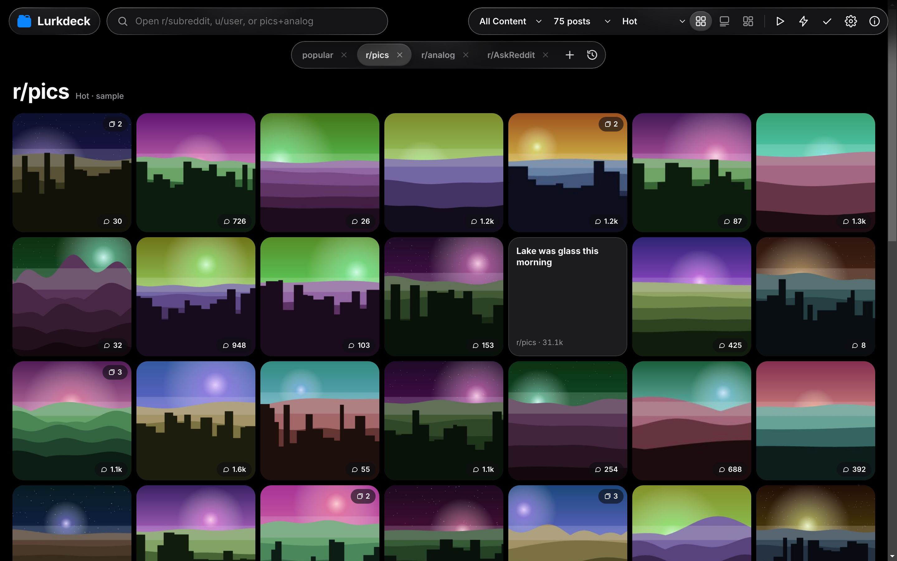
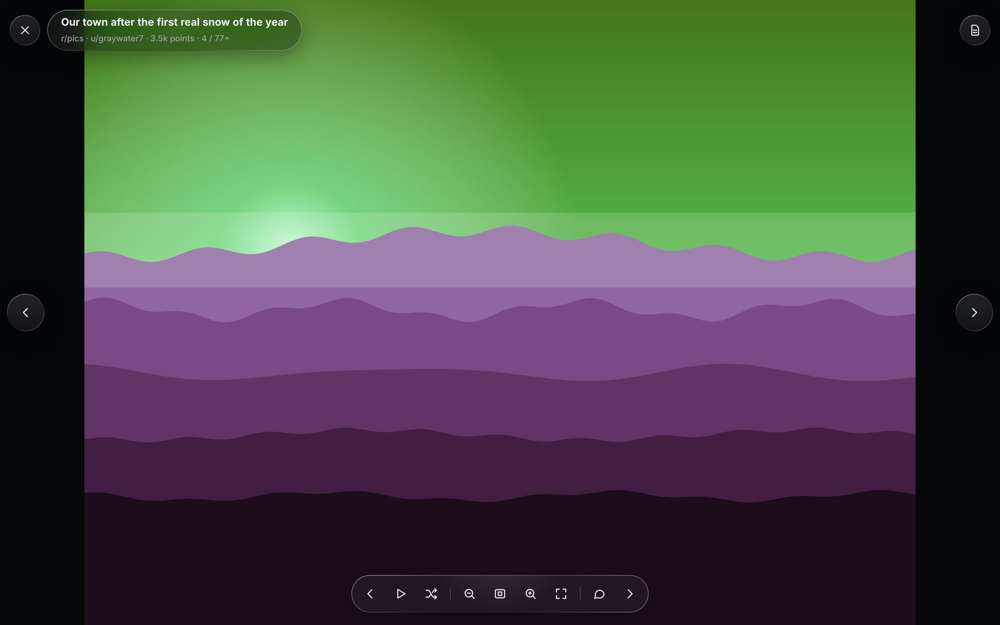
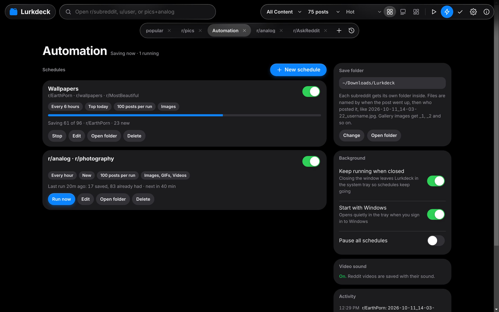
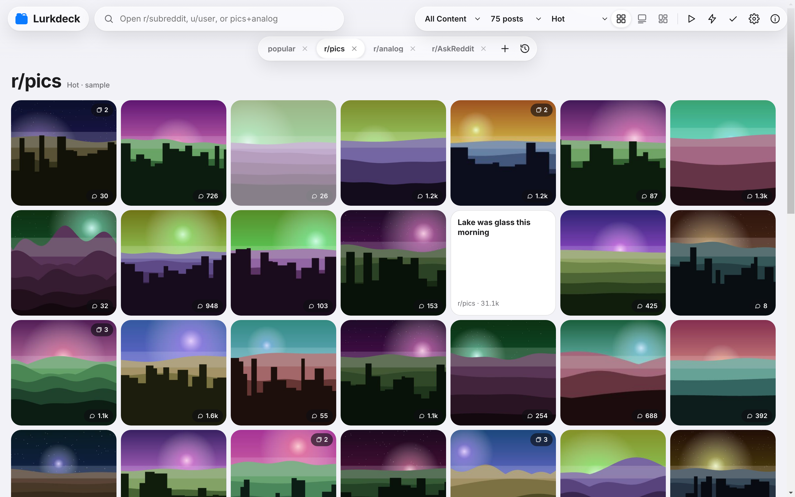

# Lurkdeck

Lurkdeck is a fast, tabbed Reddit reader for Windows and Mac, inspired by the late MultiTab for Reddit.

Lurkdeck brings back the multi-tab way of browsing Reddit that MultiTab for Reddit made popular before it shut down. Every subreddit, user or custom feed opens in its own tab, each remembering its place, so you can move between communities without losing your spot.

Photos and videos open at their original quality and fill the window. Zoom with the scroll wheel or trackpad, drag to look around, and watch Reddit videos with their sound and a proper scrub bar. Switch between grid, card and media layouts, filter to photos or videos only, or run a slide show through an entire feed.

Lurkdeck also works for you in the background. Automation saves new images, GIFs and videos from the subreddits you choose on a schedule, sorted into a folder per subreddit and named by post date and username. Feeds load ahead of you, other tabs get ready before you open them, and the app stays quick without hitting Reddit's rate limits.

It runs as a single portable Lurkdeck.exe on Windows and a native Lurkdeck.app for Apple silicon and Intel Macs, wrapped in a Liquid Glass inspired design with light and dark modes. Sign in with your Reddit account to vote, save posts and open your subscriptions as tabs.

> **First launch needs a one time download.** Lurkdeck is small because the engine that runs it is downloaded separately the first time you open it: Electron 33.2.1, about 110 MB on Windows or 100 MB on Mac, straight from Electron's official GitHub release. After that, Lurkdeck opens instantly and never downloads the engine again.

## Screenshots

## Downloads

| Platform | File | Size |
| --- | --- | --- |
| Windows 10 or 11 (64-bit) | Lurkdeck.exe | 6 MB |
| Mac, Apple silicon and Intel | Lurkdeck-Mac.zip | 5 MB |

Both are on the [Releases](../../releases) page, and both download their engine on first launch.

## Getting started on Windows

1. Download **Lurkdeck.exe** from the [Releases](../../releases) page.
2. Put it wherever you like, such as your Desktop, Documents or a USB drive.
3. Double click it. If Windows shows "Windows protected your PC", choose **More info**, then **Run anyway**. This appears because Lurkdeck.exe isn't code signed.
4. Lurkdeck asks to download its engine. It checks the download against Electron's published SHA-256 fingerprint and stores it in a **Lurkdeck Files** folder next to the exe, together with your settings.
5. Lurkdeck opens. Every launch after this one is instant.

**Moving Lurkdeck:** keep Lurkdeck.exe and the Lurkdeck Files folder together. Copy both to another PC or a USB drive and Lurkdeck runs there with no download.

**No internet on the first run?** On another computer, download `electron-v33.2.1-win32-x64.zip` from [Electron's v33.2.1 release](https://github.com/electron/electron/releases/tag/v33.2.1) and place it next to Lurkdeck.exe. Lurkdeck verifies it and uses it instead of going online.

**Updating:** replace Lurkdeck.exe with the new version. Your engine, settings, sign-ins and schedules stay where they are.

**Removing:** turn off Start with Windows in the Automation tab if you enabled it, quit Lurkdeck, and delete Lurkdeck.exe and the Lurkdeck Files folder.

## Getting started on Mac

1. Download **Lurkdeck-Mac.zip** from the [Releases](../../releases) page and open it.
2. Drag **Lurkdeck.app** into your Applications folder.
3. Open Lurkdeck. Because it isn't notarized by Apple, macOS says it can't verify the app. Click **Done**, then open **System Settings**, go to **Privacy & Security**, scroll to the message about Lurkdeck, and click **Open Anyway**. On macOS 14 Sonoma and earlier, you can instead right click Lurkdeck.app, choose **Open**, then click **Open**.
4. Lurkdeck asks to download its engine for your Mac's chip, Apple silicon or Intel, and checks it against Electron's published fingerprint. Apple silicon Macs always get the native engine, even if Lurkdeck was opened with Rosetta.
5. If macOS asks whether Lurkdeck can use "Lurkdeck Safe Storage" in your Keychain, click **Always Allow**. That's where your Reddit sign-in is kept.

**Where things are kept:** Lurkdeck keeps its engine in `~/Library/Application Support/Lurkdeck` and your settings, tabs, schedules and sign-ins in the `data` folder inside it.

**Made for the Mac:** the window's traffic light buttons sit inside the glass toolbar, the menu bar has the standard Lurkdeck, Edit, View and Window menus, Command shortcuts work throughout, and the trackpad pinches and scrolls to zoom in the viewer. When schedules run in the background, Lurkdeck lives in the menu bar, and **Open at login** in the Automation tab starts it quietly when you log in.

**Updating:** replace Lurkdeck.app in Applications with the new version. Your engine and data stay where they are.

**Removing:** turn off Open at login, quit Lurkdeck, move Lurkdeck.app to the Trash, and delete `~/Library/Application Support/Lurkdeck`.

**Running slowly?** Open Settings and set **Glass effects** to **Light**. It turns off the live blur behind the floating controls, which helps on busy feeds and older Macs.

## Requirements

Windows 10 or 11 (64-bit), or macOS 11 Big Sur or later on an Apple silicon or Intel Mac. An internet connection for the one time engine download and for browsing Reddit.

## Features

**Tabs.** Every feed opens in its own tab and keeps its own sort, layout and scroll position. Right click a tab for Close, Close all but this, Close tabs to the right, Refresh, Mark all as read, Duplicate and Copy link. Middle click closes a tab, drag tabs to reorder them, and Tab history brings back anything you closed. Combine subreddits with a plus sign, such as `analog+photography`, or save them as named custom feeds.

**Layouts and filters.** Grid for fast scanning, Card for reading, and Media for an image focused wall. The Show menu limits every tab to All Content, Media Only, Photo Only or Video Only, and Posts per load chooses 25, 50, 75, 100, 125, 150 or 200 posts at a time.

**Viewer.** Media opens at its original resolution, fitted to the window or filling it edge to edge. The scroll wheel zooms at the pointer while staying sharp, and you can drag to move around. Reddit videos play their best stream with synced sound and glass playback controls. Run a slide show or a shuffled slide show through a whole feed, and open comments right beside the media.

**Automation.** Create schedules that check subreddits every 15 minutes up to once a day and save new images, GIFs and videos. Files go to `Downloads\Lurkdeck\<subreddit>\` on Windows or `~/Downloads/Lurkdeck/<subreddit>/` on Mac, named by the post's date and time and the poster's username, for example `2026-10-11_14-03-22_username.jpg`, with each file's date set to the post date. Anything already saved is skipped. Lurkdeck can keep running in the system tray or menu bar and start with Windows or open at login on Mac, so schedules keep going.

**Video sound in downloads.** Reddit stores a video's sound separately. Click **Turn on video sound** once in the Automation tab and Lurkdeck downloads ffmpeg (a pinned release from GitHub for your system, verified by fingerprint) to join video and sound into one file.

**Faster browsing.** The next page loads before you reach it, other tabs load quietly in the background, comments start loading when you hover a post, and each feed opens instantly with the posts you saw last time while fresh ones load. Background loading backs off on its own when Reddit's request limit runs low, and you can turn it off in Settings.

**Your account.** Sign in from Settings to vote, save posts, open Home and Saved, and see your subscribed subreddits as one click tabs. Add more than one account and switch between them. Lurkdeck never sees your Reddit password; you sign in on Reddit's own page.

**Design.** A Liquid Glass inspired interface with floating glass controls and light and dark modes that follow your system. The Glass effects setting switches to a lighter style for older or busy machines, and the About screen shows which engine is running.

## Keyboard shortcuts

| Where | Keys | Action |
| --- | --- | --- |
| Anywhere | Ctrl+T (Cmd+T on Mac) | Open a feed in a new tab |
| Anywhere | Alt+W (Cmd+W on Mac) | Close the current tab |
| Anywhere | [ and ] | Previous and next tab |
| Anywhere | / | Jump to the search box |
| Viewer | Left and Right arrows | Previous and next post |
| Viewer | + and - | Zoom in and out |
| Viewer | 0 and 1 | Fit to window, actual size |
| Viewer | F | Fill the window |
| Viewer | Space | Pause or play a video; slide show on pictures |
| Viewer | P | Slide show |
| Viewer | S | Shuffle |
| Viewer | Shift+Left and Shift+Right | Skip a video back or forward 5 seconds |
| Viewer | M | Mute |
| Viewer | C | Comments |
| Viewer | Esc | Close |

## Privacy

Lurkdeck has no analytics, tracking or servers of its own. It talks only to Reddit, to Reddit's media hosts, and to GitHub for the one time engine download and the optional video sound helper. Your settings, tabs, schedules and download history stay on your computer, in the Lurkdeck Files folder on Windows or in `~/Library/Application Support/Lurkdeck` on Mac. Reddit sign-ins are encrypted with Windows' built-in data protection or kept in your Mac's Keychain, and never leave your computer.

## Support

Lurkdeck is free. If it's useful to you, you can support its development on [Buy Me a Coffee](https://www.buymeacoffee.com/joshuah1998).
Email me here: joshuah-support@proton.me

## License

Copyright 2026 Joshua H.

Lurkdeck is free for personal, noncommercial use under the [PolyForm Strict License 1.0.0](https://polyformproject.org/licenses/strict/1.0.0). You may use it, but you may not modify it or distribute copies of it. See the [LICENSE](LICENSE) file for the full terms. The Electron engine Lurkdeck downloads is covered by its own open source licenses.

Lurkdeck is an independent project and is not affiliated with or endorsed by Reddit, Inc.
